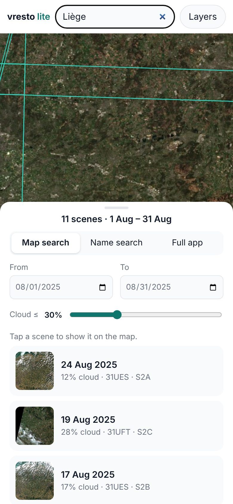
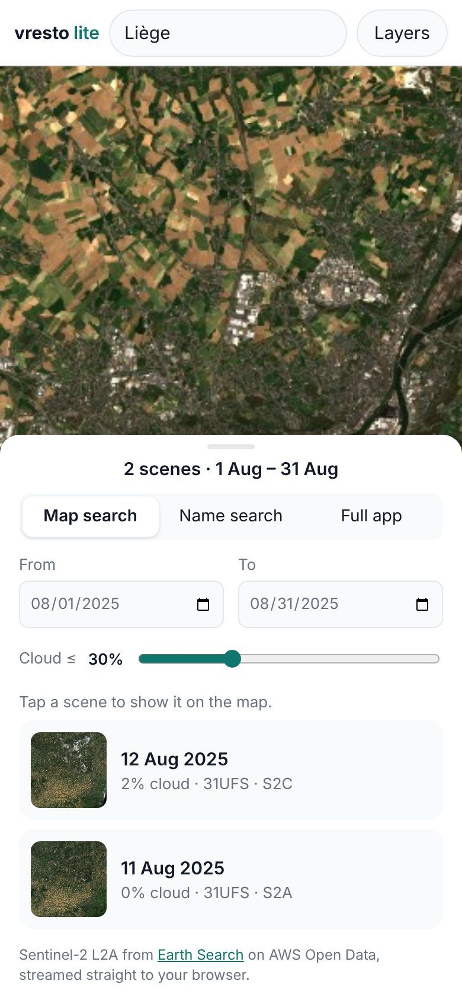
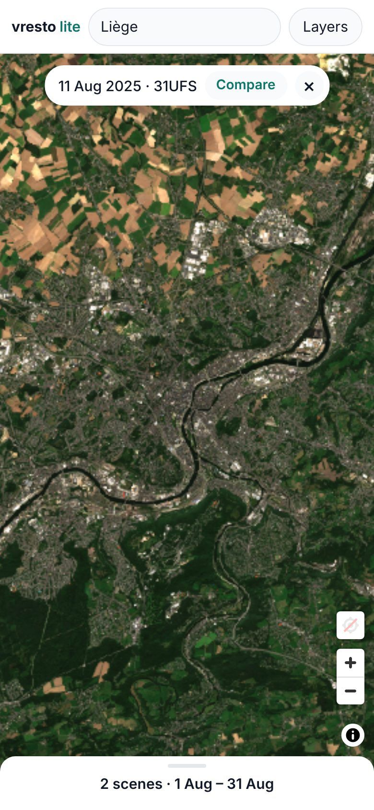
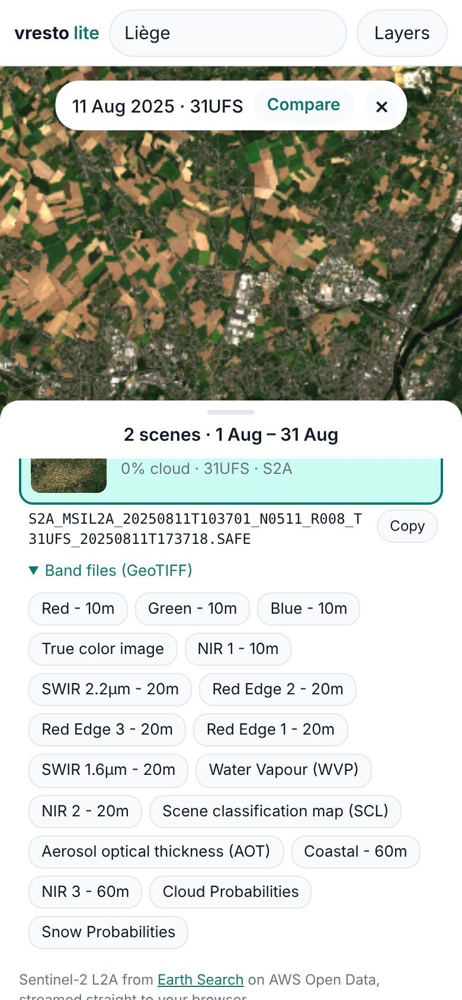
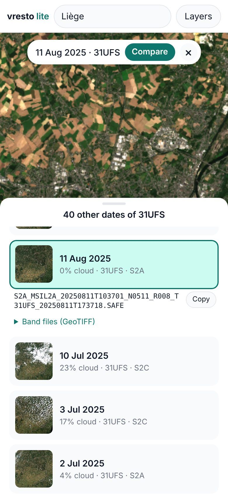
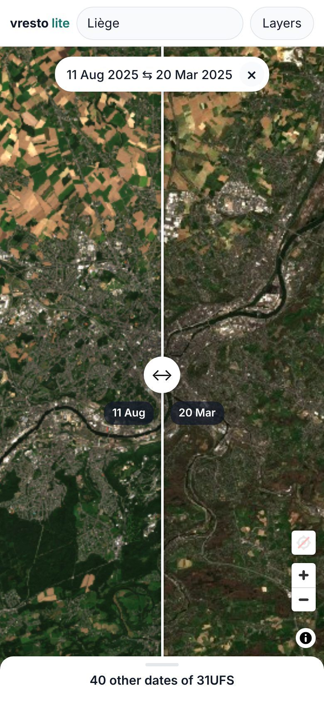
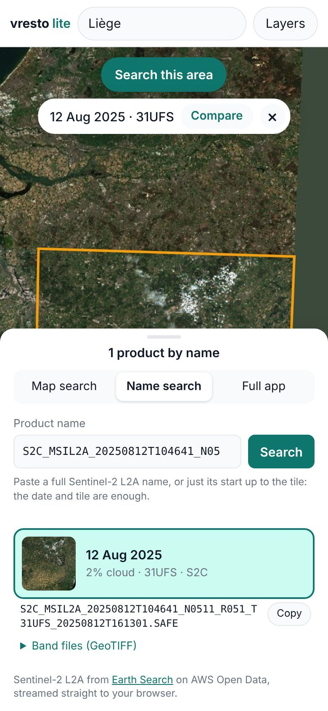
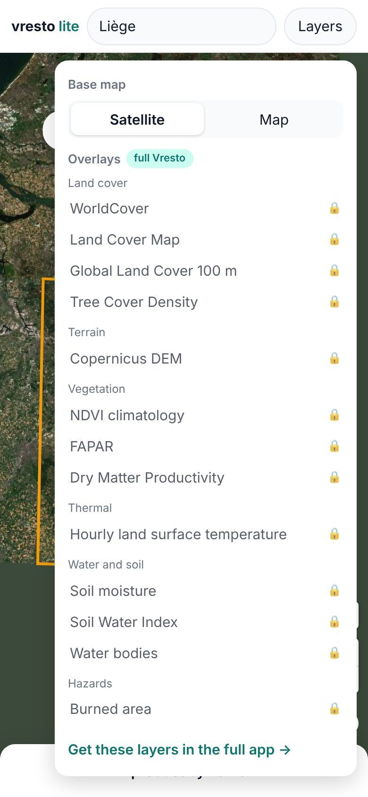
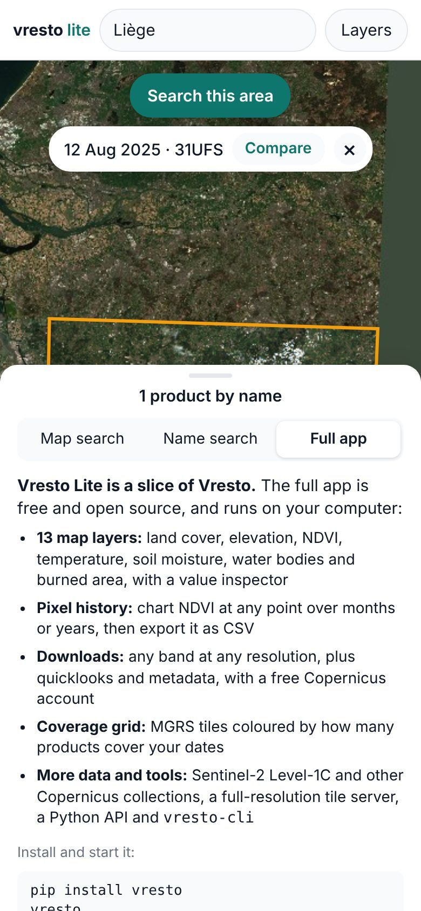
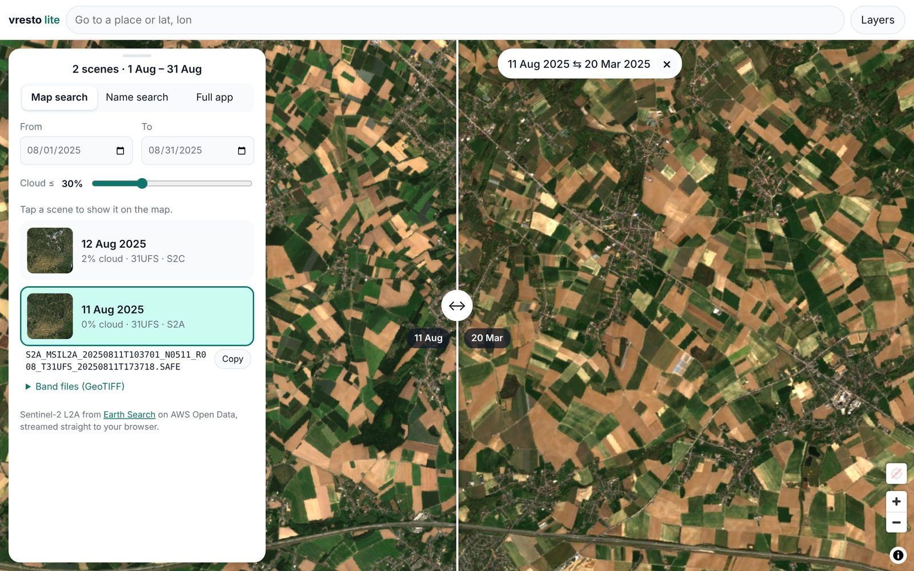

# Vresto Lite tutorial

[Vresto Lite](https://kalfasyan.github.io/vresto/app/) puts Sentinel-2 satellite imagery on your phone or laptop in a few taps. There is nothing to install and no account to create: open the link and start exploring.

This tour takes about five minutes. We will find the city of Liège in Belgium, look at it from space at 10 m per pixel, and see how it changed between March and August.

!!! tip "Open it next to this page"
    **[kalfasyan.github.io/vresto/app](https://kalfasyan.github.io/vresto/app/)** works in any modern browser. On a phone, you can add it to your home screen for an app-like shortcut.

---

## 1. Go to a place

{ .phone loading="lazy" }

Type a place name, or coordinates such as `50.63, 5.57`, into the box at the top and press **Enter**.

The map flies there and searches right away. Every outline on the map is one Sentinel-2 scene: a 110 km square photographed on one day.

!!! note "Moved the map yourself?"
    After you pan or zoom, a **Search this area** button appears at the top. Tap it to search where you are now looking.

## 2. Pick your dates and cloud limit

{ .phone loading="lazy" }

The panel at the bottom (on a computer, on the left) lists the scenes it found, newest first. Each card shows the date, how cloudy the scene is, its tile code and the satellite that took it. The small picture is a preview of the whole scene.

- **From / To** set the dates to search.
- **Cloud ≤** hides scenes that are cloudier than the limit. Slide it down for clearer pictures, up when you need more dates.

Tap the bar at the top of the panel to fold it away or bring it back.

## 3. Tap a scene to see it

{ .phone loading="lazy" }

Tap a card. The panel folds down and the scene streams onto the map in full colour, straight from AWS Open Data. Pinch or scroll to zoom in: you can see down to single fields and streets (10 m pixels).

The pill at the top tells you which date you are looking at. Tap **×** to hide the imagery again.

## 4. Copy the product name or open the band files

{ .phone loading="lazy" }

Open the panel again. Under the scene you picked you will find:

- its **exact product name**, the one Copernicus uses. Tap **Copy** to paste it into a paper, a script or the full Vresto app;
- **Band files (GeoTIFF)**: direct links to every band (red, green, blue, near-infrared, SWIR, scene classification and more). Open them in QGIS, Python or any GIS tool. No login is needed.

## 5. Compare two dates with a swipe

This is the fun part. With a scene showing, tap **Compare** in the pill at the top.

The list now shows other dates of the **same tile**, up to half a year before and after, so both pictures line up exactly. Tap the date you want to compare with.

{ .phone loading="lazy" }

A divider appears in the middle of the map: your first date on the left, the second on the right. **Drag the ↔ handle** left and right to wipe between them. Pan and zoom as usual, both sides follow.

Here you can see the bare trees and brown fields of 20 March next to the green summer of 11 August.

{ .phone loading="lazy" }

Tap **×** in the pill to stop comparing.

## 6. Share what you see

The address in your browser always holds your view: the place, the zoom, the dates, the scene and the comparison. Copy it and send it to anyone, and they will open exactly the same picture. This is handy for teaching, field work or a quick "look at this!".

## 7. Find a product by its name

{ .phone loading="lazy" }

Already have a product name, for example from a paper or a colleague? Open the **Name search** tab, paste it and tap **Search**.

You don't need the whole name: the start up to the tile code is enough, like `S2C_MSIL2A_20250812T104641_N0511_R051_T31UFS`. Vresto Lite finds the product and shows it on the map.

## 8. Change the base map

{ .phone loading="lazy" }

Tap **Layers** at the top right to switch the background between **Satellite** and a street **Map**.

The same menu lists the extra layers of the full Vresto app, such as land cover, elevation, NDVI and soil moisture. They are marked with a lock: tap one to see how to get it.

## 9. Want more? Try the full app

{ .phone loading="lazy" }

The **Full app** tab explains what the full, free Vresto adds: 13 map layers, NDVI history charts with CSV export, downloads of any band, a coverage grid, Level-1C data and a Python API. It runs on your own computer:

```bash
pip install vresto
vresto
```

If the full app is already running, **Open this view in your Vresto** takes your current place, dates and scene with you.

See [Installation & Setup](setup.md) for details.

---

## On a computer

Everything works the same on a laptop or desktop. The panel sits on the left, so you get a big map for comparing dates.

{ loading="lazy" }

## Quick tips

| I want to… | Do this |
| --- | --- |
| See clearer pictures | Slide **Cloud ≤** down |
| Find more dates | Widen **From / To**, or slide **Cloud ≤** up |
| Look somewhere else | Type a place, or pan the map and tap **Search this area** |
| Find where I am | Tap the location button above the **+ / −** buttons |
| See change over time | Show a scene, tap **Compare**, pick another date, drag **↔** |
| Cite or reuse a scene | Open the panel and tap **Copy** under the scene |
| Get the raw data | Open **Band files (GeoTIFF)** under the scene |
| Show a friend | Copy the address from your browser |

## Good to know

- **What data is it?** Sentinel-2 Level-2A (surface reflectance) from the [Earth Search](https://element84.com/earth-search/) catalogue on AWS Open Data. New scenes appear a few hours to a day after they are taken.
- **Why is part of a scene black or missing?** Many scenes sit on the edge of the satellite's path and only cover part of the tile. Pick another date, or a neighbouring tile.
- **Imagery loads slowly?** Each tile is read straight from the original files in your browser, so the first view of a scene can take a few seconds on a slow connection.
- **Is anything stored?** No. Vresto Lite has no server and no account; your searches go straight from your browser to the public catalogue.

*Screenshots show real Sentinel-2 scenes of Liège, Belgium, from 2025 (contains modified Copernicus Sentinel data).*
